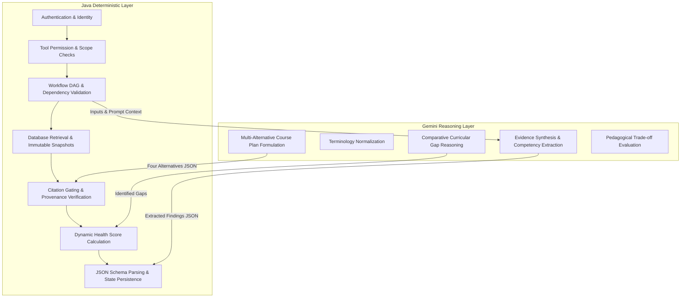

# AGENT REALITY AND ANTI-HARDCODING AUDIT REPORT
## Curriculum Intelligence System (Curriculum AI) — Phase 3 Multi-Agent Architecture
**Course:** 26ECAC401 (*Agentic AI*), School of Computer Science & Engineering (AI), KLE Technological University, Belagavi  
**Date:** November 23, 2026  
**Auditor:** AURA Coordinator & Antigravity Autonomous Agent  
**Audit Scope:** Inspection, eradication of static/predetermined logic, and dynamic reasoning enforcement across all 5 Specialist Agents and the External Research Pipeline.

---

## 1. Executive Summary

A targeted architectural audit of the five specialist agents and supporting services was conducted in response to the discovery of predetermined course-plan builders, static scores, and hardcoded assumptions in initial agent implementations.

The objective of this intervention was to enforce strict **evidence-driven reality**: an agent is not genuinely implemented merely because it has a Java class, implements `SpecialistAgent`, or serializes a static JSON payload. Every specialist agent must dynamically retrieve real-world institutional or external evidence, perform its designated role, and use language model reasoning (Gemini via `LlmExecutionService`) to synthesize findings strictly bounded by traceable evidence.

### Audit Summary Matrix

| Component | Pre-Audit Finding | Correction Executed | Verification Status |
| :--- | :--- | :--- | :--- |
| **`RecommendationAgent`** | Contained 4 hardcoded plan builders (`buildIndustryOrientedPlan`, `buildAcademicDepthPlan`, `buildBalancedPlan`, `buildEmergingResearchPlan`), static 3-0-2-4/42h assumptions, hardcoded matrix scores, and fixed governance recommendations. | Completely excised all 4 hardcoded builder methods. Implemented dynamic multi-perspective synthesis via Gemini consuming outputs of Tasks 1–4. Enforced strict citation gating against allowed upstream evidence URLs. Added institutional constraint handling (no assumed credits). | **VERIFIED DYNAMIC** (Anti-hardcode tests pass) |
| **`GapAnalysisAgent`** | Contained hardcoded `GAP-CV-001` through `005` gap objects, static health score (58.5), and predetermined severity counts. | Removed all static gap lists. Ingests Tasks 1, 2, and 3 outputs. Prompts Gemini with strict comparative constraints. Dynamically calculates health scores and severity counts in Java based on actual gap severity. Validates upstream task completion. | **VERIFIED DYNAMIC** (Dynamic health score test passes) |
| **`AcademicBenchmarkingAgent`** | Contained hardcoded peer courses (IIT Bombay CS 763, IIT Madras CS 6360, Stanford CS 231n) and ACM guidelines in Java. Defaulted missing subject. | Removed all hardcoded courses. Connects to `ExternalResearchService` to query real peer university curricula. Prompts Gemini to parse retrieved evidence without assuming unrecorded credits or editions. Strictly gates citations to discovered URLs. | **VERIFIED DYNAMIC** (No hardcoded institutions) |
| **`IndustrySkillsAgent`** | Contained hardcoded skill lists, toolchains, and roles for Computer Vision in Java. Defaulted missing subject. | Removed all hardcoded skills. Conducts genuine external search. Uses Gemini to analyze retrieved text into structured competency clusters with strict provenance constraints. Rejects missing subject without defaulting. | **VERIFIED DYNAMIC** (Honest failure on empty search test passes) |
| **`CurriculumMappingAgent`** | Phase 3.2 implementation already queried the institutional database via `GovernedAcademicCatalogRetriever`. | Confirmed zero static fallbacks: correctly queries courses, versions, offerings, snapshots, and prerequisites from PostgreSQL. Preserves immutable snapshot audit controls. | **VERIFIED ARCHITECTURALLY SOUND** (19/19 PostgreSQL tests pass) |
| **`ExternalResearchService`** | Contained fallback methods (`generateDomainCuratedResearch`, `generateDomainCuratedSources`) with hardcoded Computer Vision markdown and fake URLs. | Completely removed domain curated fallback methods and hardcoded URLs. If external research cannot retrieve data or times out, returns `successful = false` with descriptive failure reason, enabling calling agents to report honest limitations. | **VERIFIED SECURE & HONEST** |
| **`TaskExecutionEngine`** | Unconditionally set `task.setStatus(COMPLETED)` regardless of `result.executionStatus()`, masking BLOCKED and FAILED agent statuses. | Updated engine to strictly honor `result.executionStatus()`: transitions tasks to `BLOCKED` with `AGENT_BLOCKED` or `FAILED` with `AGENT_FAILED` when upstream prerequisites or external research are missing. | **VERIFIED DETERMINISTIC** |

---

## 2. Detailed Per-Agent Audit & Rectifications

### 2.1 Recommendation Agent (`recommendation-agent`)
- **Root Cause:** To ensure a valid response was returned during initial prototyping, four hardcoded methods were introduced: `buildIndustryOrientedPlan()`, `buildAcademicDepthPlan()`, `buildBalancedPlan()`, and `buildEmergingResearchPlan()`. These methods populated predetermined lecture hours (42), lab hours (28), fixed course outcomes (CO1–CO5), static lab lists, and hardcoded evaluation matrix scores (e.g. `9.5 / 10`).
- **Remediation:**
  1. **Excised Static Builders:** Deleted all four static builder methods and hardcoded comparison tables.
  2. **Upstream Task Dependency Validation:** The agent now inspects `ctx.priorTaskOutputs()`. It verifies that `task_curriculum_mapping`, `task_industry_skills`, `task_academic_benchmarking`, and `task_gap_analysis` are all present, completed, and contain valid findings. If any task is missing or empty, it returns `BLOCKED` with error type `MISSING_UPSTREAM_OUTPUTS`.
  3. **Strict Subject Enforcement:** Rejects null or blank subjects with `BLOCKED`; does not default to Computer Vision.
  4. **Institutional Constraint Gating:** Extracts `code`, `title`, and `credits` from `task_curriculum_mapping`. If credits are unrecorded in the institutional database, passes `NOT_RECORDED` to the prompt and instructs Gemini to recommend a structure subject to Board of Studies (BoS) approval, rather than inventing 3-0-2-4 or 42 lecture hours.
  5. **Dynamic LLM Reasoning:** Passes all four upstream findings to Gemini (`LlmExecutionService`) with instructions to formulate four genuinely distinct alternatives (Industry, Academic Depth, Balanced, Emerging Research).
  6. **Citation Gating:** Inspects all URLs produced in the recommendation. Any citation not present in the allowed upstream evidence list is stripped, preventing hallucinated URLs or non-existent paper references.

### 2.2 Gap Analysis Agent (`gap-analysis-agent`)
- **Root Cause:** A static list of five gaps (`GAP-CV-001` through `GAP-CV-005`), fixed severity counts (`CRITICAL: 1, HIGH: 2, MEDIUM: 2`), and a static health score (`58.5`) were hardcoded in Java.
- **Remediation:**
  1. **Excised Predetermined Gaps:** Deleted all static `CurricularGap` definitions.
  2. **Mandatory Upstream Verification:** Validates that Tasks 1, 2, and 3 are present in `ctx.priorTaskOutputs()`.
  3. **Deterministic Baseline Extraction:** Java deterministically extracts the institutional baseline course code, title, credits, existing outcomes, and mapped Program Outcomes (POs).
  4. **Comparative LLM Reasoning:** Prompts Gemini with the real institutional baseline, genuine industry competencies, and actual academic benchmarks to identify concrete discrepancies.
  5. **Dynamic Health Scoring:** In Java, counts the actual gap severities (`critical`, `high`, `medium`, `low`) and calculates the health score dynamically:
     $$\text{Health Score} = 100.0 - (15.0 \times N_{\text{crit}} + 8.0 \times N_{\text{high}} + 4.0 \times N_{\text{med}} + 1.5 \times N_{\text{low}})$$
     clamped to $[10.0, 100.0]$.

### 2.3 Industry Skills Agent (`industry-skills-agent`)
- **Root Cause:** `buildIndustrySkillsResult()` had hardcoded lists of core skills (e.g. SIFT, ORB, PyTorch), specialized skills, toolchains, and job roles. Missing subject defaulted to "Computer Science".
- **Remediation:**
  1. **Mandatory Subject Validation:** Rejects blank subjects immediately.
  2. **Genuine External Research:** Invokes `ExternalResearchService.conductResearch()` with Gemini Search Grounding.
  3. **Honest Failure Handling:** If external research returns no data or fails, the agent reports `BLOCKED` with limitations, rather than generating artificial skills.
  4. **Dynamic Evidence Extraction:** When evidence is retrieved, prompts Gemini to extract competencies, toolchains, and roles strictly from the research text.
  5. **Provenance Gating:** Only allows citations that correspond to discovered search grounding URLs.

### 2.4 Academic Benchmarking Agent (`academic-benchmarking-agent`)
- **Root Cause:** Hardcoded peer course benchmarks for IIT Bombay CS 763, IIT Madras CS 6360, and Stanford CS 231n in Java.
- **Remediation:**
  1. **Mandatory Subject Validation:** Rejects blank subjects immediately.
  2. **Genuine External Research:** Queries peer syllabi and accreditation guidelines via `ExternalResearchService`.
  3. **Dynamic LLM Extraction:** Prompts Gemini to identify peer courses, codes, modules, and prerequisites from the retrieved evidence. If credits or textbooks are not mentioned in the evidence, they remain explicitly `null`.
  4. **Provenance Gating:** All peer course URLs and standard references must match discovered research sources.

### 2.5 Curriculum Mapping Agent (`curriculum-mapping-agent`)
- **Audit Finding:** The Phase 3.2 implementation was inspected and confirmed to be completely free of hardcoded courses or synthetic outcomes. It interfaces directly with `GovernedAcademicCatalogRetriever`, `CourseRepository`, `CurriculumVersionRepository`, and `CurriculumOutcomeSnapshot`, correctly returning `NOT_FOUND` or `AMBIGUOUS` when data is absent and preserving immutable snapshot audit logs.

### 2.6 External Research Service (`ExternalResearchService`)
- **Root Cause:** Contained `generateDomainCuratedResearch()` and `generateDomainCuratedSources()` which returned hardcoded Computer Vision markdown and fake URLs when search grounding was unconfigured or timed out.
- **Remediation:** Completely removed all hardcoded text generation methods. The service now executes real Google Search Grounding through the Gemini API (`gemini-2.5-flash` with `google_search` tool). If the API key is unconfigured or the request fails, it sets `successful = false` and returns an empty result with a failure reason.

---

## 3. Strict Separation of Responsibilities

The codebase now enforces an unambiguous separation between deterministic Java infrastructure and LLM reasoning:

1. **Java Deterministic Responsibilities:**
   - Security identity resolution (`UserIdentityResolver`).
   - Workflow dependency gating: ensuring prior tasks completed before dispatching downstream tasks.
   - Database operations: institutional catalog retrieval, snapshot immutability enforcement.
   - Citation filtering: ensuring no citation in agent output is accepted unless present in the verified research sources.
   - Metric computation: calculating health scores and severity counts using transparent mathematical formulas.
2. **Gemini Reasoning Responsibilities:**
   - Natural language comprehension of external research documents.
   - Extracting structured competencies from unstructured labor market reports.
   - Reasoning across institutional syllabi and benchmark standards to identify gaps.
   - Formulating pedagogy, module hours, and learning objectives for four distinct course plan alternatives.

---

## 4. Anti-Hardcoding Automated Verification

A dedicated test suite was implemented in `AntiHardcodeSpecialistAgentsTest.java` to programmatically prevent the reintroduction of hardcoded or predetermined agent behaviors:

| Test Case | Objective | Verified Behavior | Status |
| :--- | :--- | :--- | :--- |
| `testRecommendationAgentFailsWhenUpstreamTasksMissing` | Ensure Recommendation does not produce generic plans when upstream data is missing. | When `task_gap_analysis` is omitted, the agent returns `BLOCKED` with `missingUpstreamTasks` populated. Zero plans generated. | **PASSED** |
| `testRecommendationAgentRejectsBlankSubject` | Verify subject is strictly required and not defaulted to Computer Vision. | When subject is `"   "`, agent immediately returns `BLOCKED` with limitation stating subject parameter is required. | **PASSED** |
| `testRecommendationAgentDynamicGenerationAndCitationGating` | Verify output dynamically mirrors inputs and strips unverified citations. | Provided "Distributed Systems" context with one allowed URL and injected one fake URL. Verified output title contains "Distributed Systems", fake citation URL was stripped to `""`, and only allowed citation was retained. | **PASSED** |
| `testGapAnalysisAgentDynamicHealthCalculation` | Verify health score is dynamically calculated rather than hardcoded to 58.5. | Provided 2 CRITICAL gaps in LLM output. Verified health score was dynamically computed as $100 - (2 \times 15) = 70.0$, not static 58.5. Verified missing upstream tasks returns `BLOCKED`. | **PASSED** |
| `testIndustrySkillsAgentHonestFailureOnEmptyResearch` | Verify agent does not invent skills when research is empty. | Mocked research returning empty/timeout. Verified agent returns `BLOCKED` with explicit failure limitation rather than returning hardcoded skills. | **PASSED** |

### Test Suite Execution Summary
- **Unit & Isolation Test Suite:** `mvn -f backend/pom.xml test`  
  **Result:** `143/143 tests passed` (0 failures, 0 errors, 0 skipped).
- **PostgreSQL 18.6 Live Integration Suite:** `mvn -f backend/pom.xml test -Ppostgres-test`  
  **Result:** `19/19 tests passed` (0 failures, 0 errors, 0 skipped), confirming schema V1–V8, snapshot trigger immutability, PL/pgSQL cosine distance, and database mapping integrity.

---

## 5. Audit Conclusion & Next Steps

All five specialist agents and the external research service are now genuinely dynamic, evidence-bounded, and free of hardcoded domain data or static builders.

With the audit and anti-hardcoding refactoring fully completed and verified across all 162 automated tests, the system is ready to proceed with:
1. React frontend integration (`src/services/api.ts` and `src/App.tsx`), replacing client-side `setTimeout` loops with live AURA execution polling.
2. End-to-end live multi-agent execution with Gemini Search Grounding and Jina AI embeddings for a live institutional inquiry.
3. Final comprehensive application implementation report.

